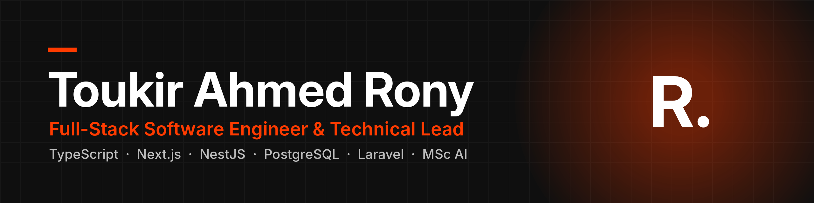

<h3>I build complete business systems — CRMs, client portals and booking platforms — from brief to production.</h3>

  
  
  

  
  

---

### 👋 About me

I'm a **Full-Stack Software Engineer and Technical Lead** with 5+ years in web and **40+ projects since 2020**, 16 of them for UK businesses in law, care, recruitment, education, construction and hospitality.

- 🏗️ I build **CRMs, client portals, booking platforms and SaaS products**, from the first brief to production
- 👥 At **SETS Tech** I lead a team of in-house and freelance developers while building core features myself
- 🔁 I've moved live client platforms from **Laravel to TypeScript monorepos** (Next.js, NestJS, PostgreSQL, Prisma)
- 🤖 **MSc in Artificial Intelligence** (University of Essex), used in real products: OpenAI chatbots, an AI voice agent, WhatsApp automation
- 📱 Currently building native **iOS (Swift) and Android** apps

> Most of my client work lives in private repositories. The projects below are public, so you can read the code.

---

### 🛠️ Tech stack

  
   
  

| Area | Tools |
|---|---|
| **Frontend** | TypeScript, Next.js, React, Tailwind CSS |
| **Backend** | NestJS, Node.js, Laravel, PHP, REST APIs, Zod |
| **Data** | PostgreSQL, Prisma, MySQL, Redis, BullMQ |
| **Quality & delivery** | Vitest, Supertest, GitHub Actions CI, Turborepo, PM2 |
| **AI** | OpenAI API, Claude API, chatbots, voice agents, workflow automation |

---

### ⭐ Featured project

<table>
<tr>
<td>

#### [📅 Slotwise](https://github.com/ToukirOfficial/slotwise) — open-source booking engine for UK businesses

A REST API, an embeddable booking widget, an owner dashboard and a background worker, for businesses that sell 1-to-1 appointments (clinics, solicitors, tutors, driving instructors).

- 🔒 **Never double-books.** PostgreSQL refuses overlapping bookings itself. 100 parallel requests for one slot give exactly 1 success and 99 rejections
- 🕐 **Correct across UK clock changes**, tested on every 2026–2027 change
- 📧 **Emails are never lost**, using an outbox, a separate worker and a send log
- 🏢 **Multi-tenant and secure**: businesses are kept apart, plus signed webhooks, rotating sessions and rate limits
- ✅ **157 tests** against real PostgreSQL and Redis, run by CI on every push

`TypeScript` `NestJS` `Next.js` `PostgreSQL` `Prisma` `Redis` `BullMQ` `Zod` `Vitest`

</td>
</tr>
</table>

---

### 💼 Selected client work

| Project | What it is | Stack |
|---|---|---|
| [**Stonebridge Legal Solutions**](https://toukirahmedrony.com/projects/stonebridge-legal) | UK law firm platform: online consultation booking and an AI chatbot | Next.js · NestJS |
| [**Zerago OS**](https://toukirahmedrony.com/projects/zerago-cleaning) | One system running a UK cleaning company: website, CMS, CRM, cleaner app, customer portal | Laravel |
| [**Community Careline**](https://toukirahmedrony.com/projects/community-careline) | UK care provider: care assessment requests and job applications | Next.js · NestJS |
| [**Mem Connects**](https://toukirahmedrony.com/projects/mem-connects) | UK study abroad consultancy: course matching, documents, application tracking | Next.js · NestJS |

<a href="https://toukirahmedrony.com/projects"><b>See all projects on my portfolio →</b></a>

---

**Hiring for a full-stack role in the UK or Ireland?** Let's talk.

<a href="https://toukirahmedrony.com">Portfolio</a> · <a href="https://www.linkedin.com/in/toukir-rony/">LinkedIn</a> · <a href="mailto:toukirofficial1996@gmail.com">Email</a>

