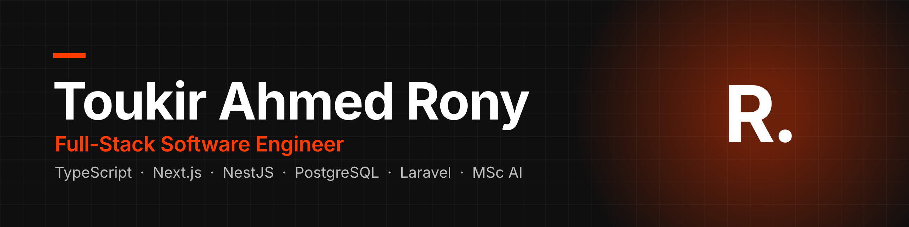

<h3>Full-stack engineer building multi-tenant SaaS in TypeScript, NestJS and PostgreSQL.</h3>

  
  
  

  
  

---

### 👋 About me

**Full-Stack Software Engineer and Technical Lead.** 5+ years building business software: **50+ projects since 2020** (18 for UK businesses in law, care, recruitment, education, construction and hospitality), plus **4 open-source systems**.

**Eligible to work in the UK · Available at short notice**

- 👥 I'm the Technical Lead at **SETS Tech**: I design the architecture and data model, plan the work, build the core of each system and lead a small team of developers and freelancers.
- 🚀 I built **StaffDock** and **RightUni** from spec to launch (multi-tenant SaaS, Next.js, NestJS, PostgreSQL).
- 🔁 I moved live client platforms from **Laravel to TypeScript monorepos**.
- 🎓 **MSc in Artificial Intelligence (Merit)**, University of Essex, used in live products: chatbots, a voice agent, WhatsApp automation.

> Most of my client work lives in private repositories. The projects below are public, so you can read the code.

---

### 🧠 How I work

- **Start with the problem.** I write the PRD and the plan, including non-functional requirements: security, performance, data retention and accessibility.
- **Design the data model and boundaries first.** Tenant isolation in the API, money as integer pence, append-only records where history matters.
- **Let the database enforce the rules that must never break**, such as an exclusion constraint against double-booking.
- **Slow or risky work goes to queues.** Every critical path is tested against real PostgreSQL and Redis in CI.
- I use AI coding tools to ship faster; I own the design, review every change and can explain every line.

---

### 🛠️ Tech stack

  
   
  

| Area | Tools |
|---|---|
| **Frontend** | TypeScript, Next.js, React, Tailwind CSS |
| **Backend** | NestJS, Node.js, Laravel, PHP, REST APIs, Zod |
| **Data** | PostgreSQL, Prisma, MySQL, Redis, BullMQ |
| **Quality & delivery** | Vitest, Supertest, GitHub Actions CI, Turborepo, PM2, Docker, Docker Compose |
| **AI** | OpenAI API, Claude API, chatbots, voice agents, workflow automation |

---

### 🔓 Open source

<table>
<tr>
<td width="50%" valign="top">

#### [📅 Slotwise](https://github.com/ToukirOfficial/slotwise)

Booking engine for UK businesses that sell 1-to-1 appointments: API, embeddable widget, owner dashboard and worker. Correct across UK clock changes.

- **No double-bookings, enforced by the database.** A PostgreSQL exclusion constraint: 100 parallel bookings for one slot → exactly 1 succeeds, 99 get 409.
- **No lost emails.** The booking and an outbox row commit in one transaction; a worker relays them with deterministic job ids and a send log.

✅ Tested in CI against real PostgreSQL and Redis · `NestJS` `Next.js` `PostgreSQL` `Prisma` `BullMQ` `Redis`

**[Live demo](https://slotwise.toukirahmedrony.com)**

</td>
<td width="50%" valign="top">

#### [🧭 Jobsmith](https://github.com/ToukirOfficial/Jobsmith)

Self-hosted job search workspace with an AI agent that runs as seven typed, schema-checked steps. It only prepares applications, never sends anything, and treats job page text as untrusted data to resist prompt injection.

- **SSRF-safe job fetching.** Every DNS answer is checked against private and cloud-metadata ranges, then the connection is pinned to the checked IP, so DNS rebinding can't swap it.
- **Fixed a production memory incident.** Streamed the 143k-row register in batches with one fixed `INSERT … unnest` instead of `createMany`, and capped the heap: worker memory 1 GB → ~250 MB.

✅ **92 tests** · `NestJS` `Next.js` `PostgreSQL` `Prisma` `BullMQ` `Zod`

**[Live demo](https://jobsmith.toukirahmedrony.com)**

</td>
</tr>
<tr>
<td width="50%" valign="top">

#### [🏠 OpenLet](https://github.com/ToukirOfficial/OpenLet)

Property and tenancy management for small landlords and letting agents, with a tenant portal and a contractor job page.

- **Append-only rent ledger in integer pence.** Mistakes are reversed, never edited, so the history always adds up.
- **Idempotent daily rent job.** A unique key on (tenancy, period start) means running it twice never charges twice, including due days on the 29th–31st.

✅ **115 tests** · `NestJS` `Next.js` `PostgreSQL` `Prisma` `BullMQ` `Redis`

**[Live demo](https://openlet.toukirahmedrony.com)**

</td>
<td width="50%" valign="top">

#### [📂 DocRequest](https://github.com/ToukirOfficial/docrequest)

Client document portal for firms that chase clients for paperwork: one secure link, upload from a phone, review and download.

- **Per-file encryption.** Each file has its own AES-256-GCM key, wrapped by a master key from the environment or AWS KMS.
- **Scan before access.** Uploads are virus-scanned on a BullMQ queue before staff can open them; client links are stored only as SHA-256 hashes.

✅ **79 tests** · `NestJS` `Next.js` `PostgreSQL` `Prisma` `BullMQ` `ClamAV`

**[Live demo](https://docrequest.toukirahmedrony.com)**

</td>
</tr>
</table>

---

### 💼 Selected client work

| Project | What it is | Stack |
|---|---|---|
| [**StaffDock**](https://toukirahmedrony.com/projects/staffdock) | UK staff document compliance SaaS, live | Next.js · NestJS · PostgreSQL · Prisma |
| [**RightUni**](https://toukirahmedrony.com/projects/rightuni) | Free study-abroad organiser with an encrypted document vault, live | Next.js · NestJS · PostgreSQL · Prisma |
| [**Stonebridge Legal Solutions**](https://toukirahmedrony.com/projects/stonebridge-legal) | UK law firm platform: online consultation booking and an AI chatbot | Next.js · NestJS |
| [**Zerago OS**](https://toukirahmedrony.com/projects/zerago-cleaning) | One system running a UK cleaning company: website, CMS, CRM, cleaner app, customer portal | Laravel |
| [**Community Careline**](https://toukirahmedrony.com/projects/community-careline) | UK care provider: care assessment requests and job applications | Next.js · NestJS |
| [**Mem Connects**](https://toukirahmedrony.com/projects/mem-connects) | UK study abroad consultancy: course matching, documents, application tracking | Next.js · NestJS |

<a href="https://toukirahmedrony.com/projects"><b>See all projects on my portfolio →</b></a>

---

**Hiring for a full-stack role in the UK?** Let's talk.

<a href="https://toukirahmedrony.com">Portfolio</a> · <a href="https://www.linkedin.com/in/toukir-rony/">LinkedIn</a> · <a href="mailto:toukirofficial1996@gmail.com">Email</a>

Based in Huddersfield, UK. Open to full-time roles in the UK (Leeds, Manchester, London, remote/hybrid).

